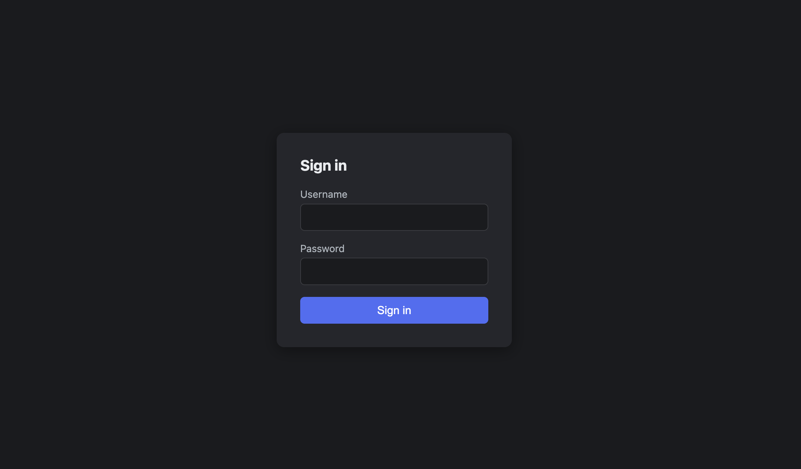

# FlexBasicAuth

<p align="center">
  
</p>

A [Traefik](https://traefik.io) middleware plugin that works like the built-in `basicAuth`
middleware, but reads the Basic credentials from a configurable request header instead of
always using `Authorization`. This lets you gate a route with Basic Auth at the edge even when
something downstream (an OpenID Connect app, a Git server, an API) already needs
`Authorization` for its own purposes.

It also ships a [cookie-based mode](#cookie-mode-a-browser-login-form-without-breaking-gitapioidc)
that serves a real HTML login form to browsers while leaving `Authorization` completely alone,
so command-line clients, API tokens, and OIDC keep authenticating exactly as they did before.

## Modes

FlexBasicAuth runs in one of three modes, selected with the `mode` option:

| Mode | Default | What it does |
|------|---------|--------------|
| [`header`](#configuration) | Yes | Validates Basic credentials from a configurable request header on every request. No login form; purely machine-to-machine. |
| [`cookie`](#cookie-mode-a-browser-login-form-without-breaking-gitapioidc) | No | Serves an HTML login form + session cookie to browsers, and leaves `Authorization` completely untouched for everything else (git, API clients, OIDC). |
| [`hybrid`](#hybrid-mode-header-mode-gating-for-everyone-a-login-form-for-browsers) | No | Combines both: browsers get the cookie-mode login form, everyone else gets the same header check as `header` mode, with no bypass for anyone. |

## Why

Traefik's built-in `basicAuth` only reads credentials from `Authorization`. Its `headerField`
option is unrelated: it just writes the authenticated username to a header for the backend, it
doesn't change where credentials are read from.

That's a problem if the backend already uses `Authorization` for its own auth, for example
OpenID Connect (`Authorization: Bearer ...`). With `basicAuth` enabled, Traefik tries to parse
the Bearer token as Basic credentials and returns 401. There's no way to keep Basic auth at the
edge and let the Bearer token through on the same route with the built-in middleware.

FlexBasicAuth reads Basic credentials from any header you pick (e.g. `X-Basic-Auth`) and leaves
`Authorization` alone when it isn't the configured header, so an OpenID Bearer token passes
through unmodified.

## Configuration

The `Modes` column shows which `mode` each option applies to; `all` means it applies regardless
of mode.

| Option         | Type     | Default                  | Modes          | Description                                                                                                                                                                 |
|----------------|----------|--------------------------|----------------|-----------------------------------------------------------------------------------------------------------------------------------------------------------------------------|
| `mode`         | string   | `header`                 | all            | Selects which mode FlexBasicAuth runs in: `header`, `cookie`, or `hybrid`. See [Modes](#modes) above.                                                                       |
| `users`        | []string | *(required)*             | all            | htpasswd-style `login:hash` entries. Supports bcrypt (`$2a$`/`$2b$`/`$2y$`), MD5-crypt/apr1 (`$apr1$`/`$1$`), and SHA1 (`{SHA}`), same formats as the built-in `basicAuth`. |
| `realm`        | string   | `traefik`                | all            | Realm sent in the `WWW-Authenticate: Basic realm="..."` response on 401.                                                                                                    |
| `header`       | string   | `Authorization`          | header, hybrid | Request header to read the `Basic <base64>` credentials from.                                                                                                               |
| `removeHeader` | bool     | `false`                  | header, hybrid | Remove the credentials header from the request before it reaches the backend.                                                                                               |
| `headerField`  | string   | `""` (disabled)          | header, hybrid | If set, write the authenticated username to this header for the backend.                                                                                                    |
| `cookieName`   | string   | *(required)*             | cookie, hybrid | Name of the session cookie. Pick something that won't collide with the backend's own session cookie (e.g. not `session`, `auth`, or `connect.sid`).                         |
| `cookieSecret` | string   | *(required)*             | cookie, hybrid | HMAC signing key for the session cookie. Treat it like a password: generate a random one, e.g. `openssl rand -hex 32`.                                                      |
| `cookieTTL`    | string   | `24h`                    | cookie, hybrid | Session lifetime, as a Go duration (`h`/`m`/`s`, no `d` for days, use e.g. `168h` for a week).                                                                              |
| `loginPath`    | string   | `/__flexbasicauth/login` | cookie, hybrid | Path the login form posts to. Pick something that doesn't collide with a real route on the backend.                                                                         |

With `header` unset (or set to `Authorization`), FlexBasicAuth behaves exactly like the built-in
`basicAuth`. Point `header` elsewhere and `Authorization` is never read, inspected, or modified.

### Example: BasicAuth + OpenID on the same route

```yaml
http:
  middlewares:
    flex-basic-auth:
      plugin:
        flexbasicauth:
          users:
            - "user:$apr1$..."
          header: "X-Basic-Auth"
          realm: "traefik"
          removeHeader: true
          headerField: "X-Authenticated-User"
```

The client sends credentials as `X-Basic-Auth: Basic <base64(user:password)>`. `removeHeader:
true` strips that header before the backend sees it, and `headerField` passes the authenticated
username along as `X-Authenticated-User`. `Authorization: Bearer <openid-token>` is never
touched, so the backend's own OIDC check keeps working.

### Kubernetes (IngressRoute / Middleware CRD)

```yaml
apiVersion: traefik.io/v1alpha1
kind: Middleware
metadata:
  name: flex-basic-auth
spec:
  plugin:
    flexbasicauth:
      users:
        - "user:$apr1$..."
      header: "X-Basic-Auth"
      removeHeader: true
      headerField: "X-Authenticated-User"
```

### Example: protecting `git clone`/`push` without colliding with the backend's own auth

Header mode checks the configured header on *every* request, unlike
[cookie mode](#cookie-mode-a-browser-login-form-without-breaking-gitapioidc), it never steps
aside just because a request already carries some other header. That makes it a better fit when
you want FlexBasicAuth to actually gate `git clone`/`push`, not just the browser, while leaving
`Authorization` completely free for the backend's own auth (a Git server login, a personal
access token, etc.).

The catch: plain `git` only ever sends credentials via `Authorization`; it has no built-in way
to populate a custom header on its own. Point it at the configured header with
[`http.extraHeader`](https://git-scm.com/docs/git-config#Documentation/git-config.txt-httpextraHeader):

```bash
echo -n "user:password" | base64
# use the output below
git -c http.extraHeader="X-Basic-Auth: Basic <base64 output above>" \
  clone https://git.example.com/user/repo.git
cd repo
git config http.extraHeader "X-Basic-Auth: Basic <base64 output above>"   # keep it for future pull/push
```

Every request from that repository now carries `X-Basic-Auth`, which FlexBasicAuth validates
against its own `users` list; `Authorization` is never touched, so the backend's own git auth
(password, personal access token, etc.) keeps working exactly as before. The header value is
base64, not encryption; treat it like a plaintext password (file permissions on `.git/config`,
HTTPS only), and set it with local `git config` (not `--global`) so it isn't sent to unrelated
git hosts.

Plain header mode has no login form at all, so it only makes sense when nothing human-facing
ever hits this route. If humans also need to browse the same host in a browser, see
[hybrid mode](#hybrid-mode-header-mode-gating-for-everyone-a-login-form-for-browsers) below,
which applies this exact check to non-browser clients while still giving browsers a login form.

## Cookie mode: a browser login form without breaking git/API/OIDC

Header mode has one limitation: a plain browser's native Basic Auth popup only ever sends
credentials through `Authorization`. If you want a normal-looking browser login (no browser
extension, no custom header) on a host where `Authorization` is already used for something
else, header mode can't do it, since the native popup would collide with that.

That's exactly the case for a backend that already relies on `Authorization` for its own clients,
for example a Git server where `git clone`/`push` over HTTPS and API tokens all use
`Authorization`. Set `mode: cookie` instead, and FlexBasicAuth serves its own
login form and, after a successful login, sets a signed session cookie. Browsers send cookies
automatically on every request, so the user logs in once and stays logged in, without ever
touching `Authorization`.

<p align="center">
  
</p>

### How browser and command-line clients are told apart

The same rule from header mode still applies and is the reason nothing breaks: **if a request
already carries `Authorization`, FlexBasicAuth does not touch it at all** and passes the request
straight through. `git`, API clients, and OIDC Bearer tokens all send `Authorization`, so they
never see the cookie gate.

For requests with no `Authorization` and no valid session cookie yet, FlexBasicAuth has to
decide whether to show an HTML login page or a plain HTTP challenge, and it does that by
checking the `Accept` header:

- **If a browser makes the request** (`Accept: text/html,...`):
  it gets a login form. Submitting the form sets a session cookie and redirects the user back to the page 
  they were trying to reach.

- **Everything else (git, curl, API clients they send `Accept: */*` )**
  gets a plain `401 Unauthorized` with `WWW-Authenticate: Basic`. This is the standard challenge these 
  tools already know how to handle: they retry the same request with their own credentials in `Authorization`
  (credentials embedded in the remote URL, a credential helper, an API token, whatever they already use for that host). 
  That retry then passes straight through by the rule above, so the backend's own auth (a Git server, an API, OIDC) 
  handles it exactly as if FlexBasicAuth weren't there.

In short: a browser gets a real login page; a command-line client gets a normal 401 challenge
and authenticates however it already does against the backend. Neither one ever has to know
about the other.

This bypass rule is a deliberate trade-off, not a loophole: cookie mode's `users` list only ever
gates browsers. Any client that already sends *some* `Authorization` (valid or not) skips
FlexBasicAuth entirely and is fully at the mercy of whatever the backend itself does with it. If
the backend doesn't properly reject bad or missing credentials on its own (for example, it
allows anonymous access to something you meant to lock down), this bypass means FlexBasicAuth
adds no protection there at all. If you need FlexBasicAuth itself to gate those clients too, use
[hybrid mode](#hybrid-mode-header-mode-gating-for-everyone-a-login-form-for-browsers) instead.

The cookie is set with `HttpOnly`, `Secure`, and `SameSite=Lax`, and no `Domain` attribute (so
it's scoped to the exact host). It's read only by exact name, so any other cookies already in
the request (a backend session cookie, a CSRF cookie, anything) are left untouched and still
reach the backend normally.

`users` is a list, not a single account. Add one `login:hash` entry per person who needs
browser access:

```yaml
users:
  - "admin:$apr1$..."
  - "alice:$apr1$..."
```

Each person logs in with their own entry, and the session cookie is signed with the username
that actually logged in, so everyone gets their own independent session. This is still a gate
in front of the backend, not a replacement for whatever login system the backend itself has:
these credentials only control who gets past FlexBasicAuth, they have nothing to do with the
backend's own user accounts (a Git server login, API tokens, etc.), which keep working exactly as
they did before, over `Authorization`.

### Example: gating a self-hosted Git server's web UI without breaking git/API

```yaml
apiVersion: traefik.io/v1alpha1
kind: Middleware
metadata:
  name: flex-basic-auth-cookie
spec:
  plugin:
    flexbasicauth:
      users:
        - "admin:$apr1$..."
      mode: "cookie"
      cookieName: "flex_basic_auth_session"
      cookieSecret: "<openssl rand -hex 32>"
      cookieTTL: "168h"
      loginPath: "/__flexbasicauth/login"
```

Attach this middleware to the Git server's route. Browsing to the host shows a login form; `git
clone`/`push` and API/token access keep working exactly as before, untouched.

## Hybrid mode: header-mode gating for everyone, a login form for browsers

Cookie mode's bypass rule means FlexBasicAuth never actually checks anything for clients that
already send `Authorization`; it just steps aside and trusts the backend completely (see
above). `mode: "hybrid"` removes that bypass: it dispatches on the same `Accept` header, but
instead of trusting non-browser clients, it runs the exact same check as header mode on them:
the configured `header`, validated against `users`, no exceptions. Browsers (`Accept:
text/html`) still get the cookie-mode login form.

- **Browser** (`Accept: text/html,...`) – login form + session cookie, identical to cookie mode.
- **Everything else** (`git`, `curl`, API clients) – header-mode check: a valid, configured
  `header` is required on every request, or it's a `401`. There is no exception for requests
  that happen to carry `Authorization`.

Because there's no bypass, `header` should point at something other than `Authorization`; same
reasoning as plain header mode (see [Why](#why)): otherwise non-browser clients would have to
authenticate twice with the same header, once against FlexBasicAuth's `users` and once against
the backend's own accounts.

```yaml
http:
  middlewares:
    flex-basic-auth:
      plugin:
        flexbasicauth:
          users:
            - "admin:$apr1$..."
          mode: "hybrid"
          header: "X-Basic-Auth"
          cookieName: "flex_basic_auth_session"
          cookieSecret: "<openssl rand -hex 32>"
          cookieTTL: "168h"
```

Browsing to the host shows the login form. `git`, unlike a browser, has no built-in way to send
a custom header; add it with
[`http.extraHeader`](https://git-scm.com/docs/git-config#Documentation/git-config.txt-httpextraHeader):

```bash
echo -n "admin:password" | base64
# use the output below
git -c http.extraHeader="X-Basic-Auth: Basic <base64 output above>" \
  clone https://git.example.com/user/repo.git
cd repo
git config http.extraHeader "X-Basic-Auth: Basic <base64 output above>"   # keep it for future pull/push
```

Without this, `git clone`/`push` would get a plain `401`: hybrid mode has no bypass, so a bare
`Authorization` (which is all `git` sends on its own) isn't enough; it needs the configured
`X-Basic-Auth` header checked against `users`. Set it with local `git config` (not `--global`),
since it's a plaintext credential in base64, not encryption, and would otherwise be sent to
every git host you talk to.

## Generating password hashes

Any htpasswd-compatible tool works:

```bash
htpasswd -nbB user password      # bcrypt
htpasswd -nbs user password      # SHA1
openssl passwd -apr1 user        # MD5-crypt / apr1
```

## Installing from the official plugin catalog

FlexBasicAuth is published on the [Traefik Plugin Catalog](https://plugins.traefik.io/plugins/6adc664bb924de020cfea82e/flex-basic-auth).
This is the recommended way to install it when Traefik can reach the plugin registry at
startup; enable it in the static configuration with `experimental.plugins` instead of
`experimental.localPlugins`:

```yaml
experimental:
  plugins:
    flexbasicauth:
      moduleName: github.com/stanislavtrubachev/flex-basic-auth-traefik
      version: v0.3.2 # pin to a tagged release from the catalog page
```

The dynamic configuration (middleware setup) is identical regardless of how the plugin is
installed; see [Configuration](#configuration) above and the examples throughout this README.

If Traefik can't reach the registry backend at startup (an air-gapped host), use
[local usage](#local-usage-plugin-without-using-a-publication) or
[installing without internet access](#installing-without-internet-access) instead.

## Local usage plugin (without using a publication)

Traefik plugins run through [yaegi](https://github.com/traefik/yaegi), not a compiler. Third-party
dependencies (here, `golang.org/x/crypto/bcrypt`) have to be vendored, since Traefik won't run
`go mod vendor` for you:

```bash
go mod vendor
```

Put the module (including `vendor/`) under
`plugins-local/src/github.com/stanislavtrubachev/flex-basic-auth-traefik` on the Traefik
host/container, and enable it in the static configuration:

```yaml
experimental:
  localPlugins:
    flexbasicauth:
      modulename: github.com/stanislavtrubachev/flex-basic-auth-traefik
```

## Installing without internet access

The catalog mode (`experimental.plugins`) requires Traefik to reach the plugin registry
backend at startup to download the module. That won't work on an air-gapped host. Use
`experimental.localPlugins` instead (same mechanism as above): it never makes a network
call, since yaegi only interprets files already on disk.

This works offline because `vendor/` is already committed to this repository: nobody needs
to run `go mod vendor` on the air-gapped host, or reach a Go module proxy at all. You only
need to get the repository's files onto that host by any transport you already have,
network or not:

- `git clone` from an internal mirror, if you have one.
- `scp`/`rsync` the repository directory from a machine that already has it.
- A tarball on a USB drive: `tar czf flexbasicauth.tar.gz -C .. flex-basic-auth-traefik`,
  copy it over, `tar xzf` on the target.

Whichever way you move it, the result has to land at
`plugins-local/src/github.com/stanislavtrubachev/flex-basic-auth-traefik` on the Traefik
host (or be mounted there as a volume, if Traefik runs in a container), with `vendor/` and
`.traefik.yml` included. Then enable it in the static configuration as shown above and
restart Traefik. No outbound network access is needed at any point.

## Development

```bash
go test ./... -race -cover
go run ./cmd/devserver   # standalone server for manual testing, not part of the plugin
```

## License

[MIT](./LICENSE)
